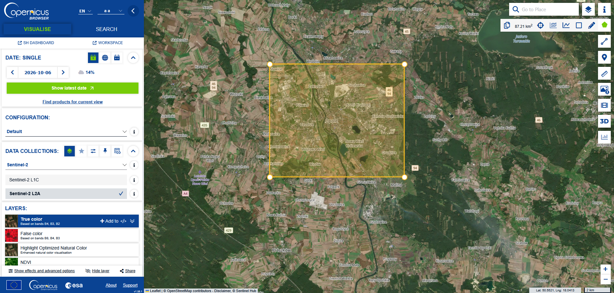
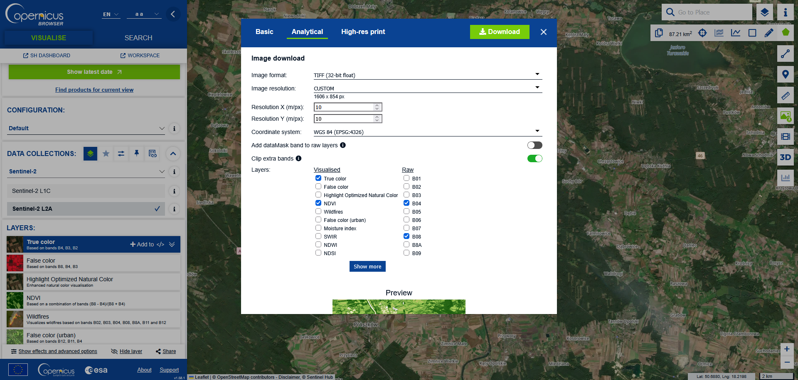
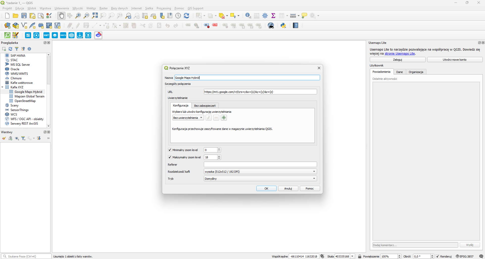
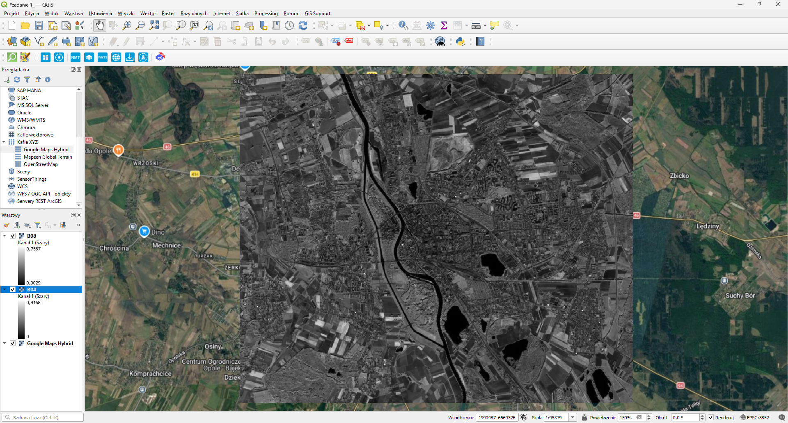
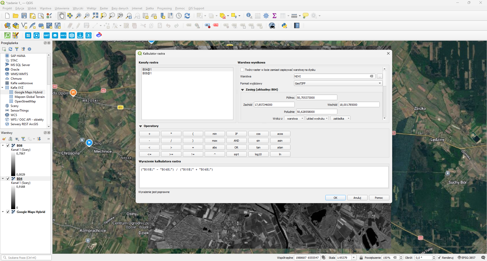
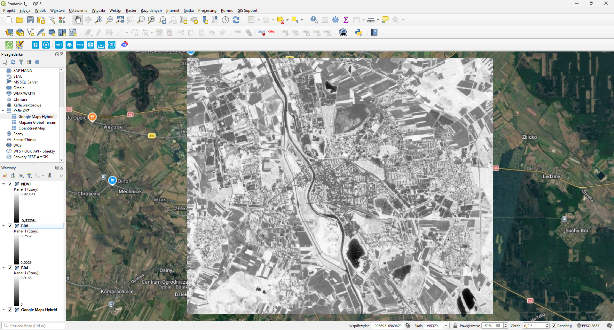
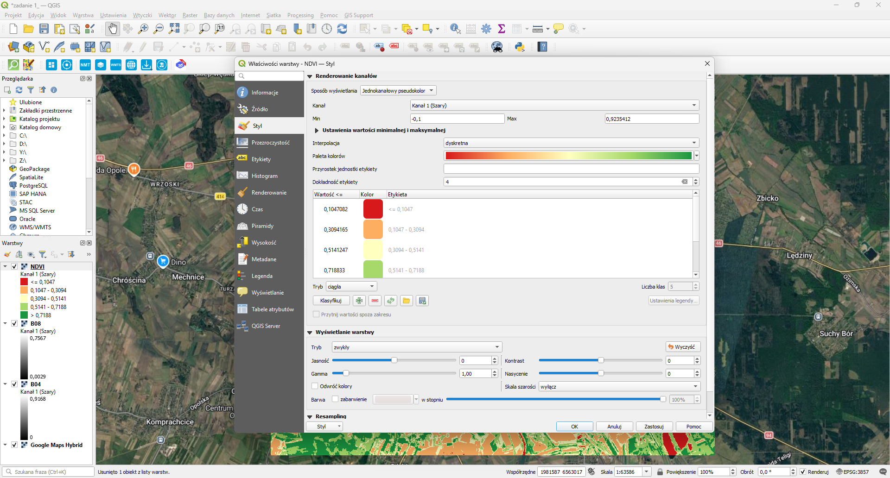
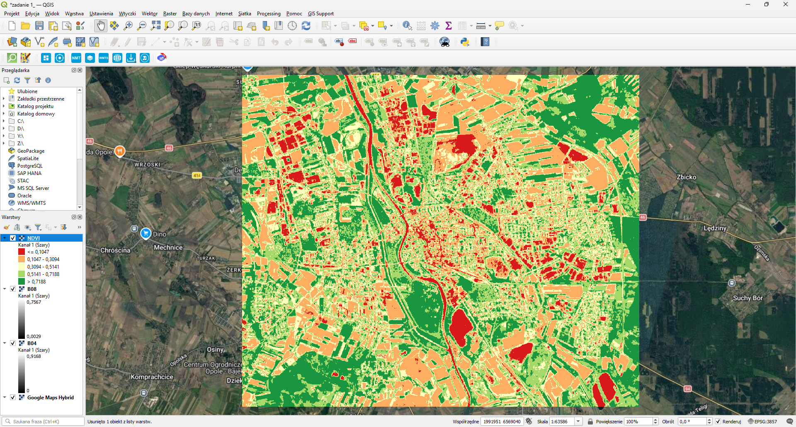
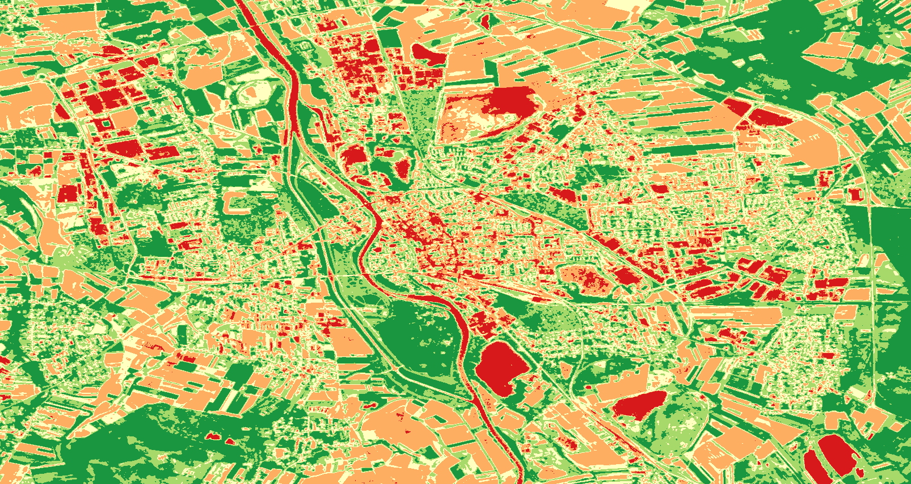
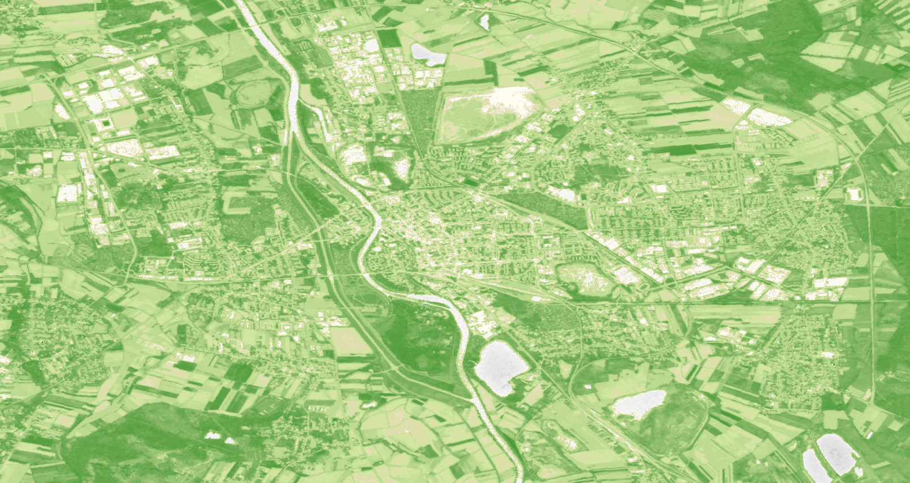

# QGIS - obliczanie NDVI

## Cel ćwiczenia

Celem ćwiczenia było obliczenie wskaźnika NDVI (Normalized Difference Vegetation Index) na podstawie danych satelitarnych udostępnionych w przeglądarce Copernicus Data Space Ecosystem, a następnie przedstawienie otrzymanego rastra w programie QGIS. Wskaźnik NDVI pozwala ocenić kondycję i intensywność roślinności na badanym obszarze.

W obliczeniach wykorzystano dwa pasma obrazu Sentinel-2:

- **B04 (RED)** – pasmo czerwone,
- **B08 (NIR)** – pasmo bliskiej podczerwieni.

Roślinność pochłania promieniowanie czerwone i silnie odbija promieniowanie bliskiej podczerwieni, dlatego różnica odbicia w tych pasmach może służyć do jej identyfikacji.

## Przeglądarka Copernicus

W przeglądarce Copernicus wybrano obszar zainteresowania oraz najnowszy dostępny obraz dla tego obszaru.


*Przeglądarka Copernicus - wybrany obszar danych do pobrania*

W zakładce Analytical wybrano format GeoTIFF z wartościami zmiennoprzecinkowymi 32-bit oraz zaznaczono pasma B04 i B08, które są niezbędne do obliczenia NDVI.


*Przeglądarka Copernicus - zakładka Analytical*

## QGIS

W programie QGIS utworzono nowy projekt i dodano mapę podkładową Google Maps, która ułatwia lokalizację analizowanego obszaru.


*QGIS - dodanie mapy podkładowej Google Maps*

Do projektu załadowano pobrane warstwy B04 i B08.


*QGIS - załadowanie warstw B04 i B08*

Do utworzenia nowej warstwy rastrowej użyto narzędzia **Raster > Kalkulator rastra**. Zastosowano wzór:

```text
NDVI = (NIR - RED) / (NIR + RED)
```

W odniesieniu do pobranych danych oznacza to:

```text
NDVI = (B08 - B04) / (B08 + B04)
```


*QGIS - obliczanie NDVI*

Wynik zapisano jako nową warstwę NDVI.


*QGIS - utworzona warstwa NDVI*

Po wykonaniu obliczeń otwarto właściwości utworzonej warstwy i w zakładce **Styl** wybrano sposób wyświetlania **Jednikanałowy pseudokolor**. Interpolacja została ustawiona na **dyskretna** i paleta kolorów na **RdYlGn** z interpolacja dyskretną. Zastosowanie skali pseudokolorowej ułatwia rozróżnienie obszarów o różnych wartościach wskaźnika i poprawia czytelność mapy.


*QGIS - ustawienia utworzonej warstwy NDVI*

## Wynik

Na końcowej mapie widoczny jest przestrzenny rozkład wartości NDVI dla analizowanego obszaru. Wartości wyższe wskazują miejsca z gęstszą i lepiej rozwiniętą roślinnością (kolor zielony), natomiast wartości niskie odpowiadają obszarom pozbawionym roślinności lub pokrytym innymi obiektami, np. zabudową (kolor pomarańczowy), drogami albo wodą (kolor czerwony). Dzięki zastosowaniu mapy podkładowej można porównać wynik klasyfikacji z rzeczywistym położeniem obiektów w terenie.


*QGIS - warstwa NDVI ze zmienionymi ustawieniami*

Wygląd warstwy NDVI zależy od wybranej palety kolorów, rodzaju interpolacji oraz wartości brzegowych przypisanych do poszczególnych kolorów. Zmiana tych ustawień wpływa na sposób wizualnego przedstawienia różnic wartości wskaźnika, mimo że same dane rastrowe pozostają niezmienione.

Poniżej przedstawiono render obliczonej warstwy NDVI w QGIS oraz warstwę NDVI pobraną bezpośrednio z przeglądarki Copernicus. Oba obrazy pozwalają porównać rezultat obliczeń wykonanych w QGIS z produktem udostępnionym przez serwis Copernicus.


*Render utworzonej warstwy NDVI w QGIS*


*Warstwa NDVI pobrana z przeglądarki Copernicus*
